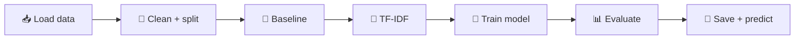

<div align="center">

# 🤖 Lab 2: Train Your First Text Classifier

### From raw text to a working model in 40 minutes


</div>

---

## 🎯 Your Mission

In **Lab 1**, you loaded the data, explored it, split it, and cleaned it. 🧹
In **Lab 2**, you use that prepared data to **train your first model**. 🚀

By the end, you will have a model that reads a project's title and description and predicts its tag:

| 📝 Input | 🏷️ Predicted tag |
|---|---|
| "Transfer learning with transformers" | `natural-language-processing` |
| "Object detection with YOLO" | `computer-vision` |

### 🗺️ The Journey



### 🆕 What's new compared to Lab 1?

| Concept | What it means |
|---|---|
| 🎲 **Baseline** | A very simple model that your real model must beat |
| 🔢 **TF-IDF** | A way to turn words into numbers |
| 🧠 **Training** | Letting the model learn from examples |
| 📊 **Precision / Recall / F1** | Scores that tell you how good the model really is |
| 💾 **Saving a model** | Reusing your model without retraining |

---

## 🧰 Setup

Install the libraries you need:

```bash
pip install pandas scikit-learn joblib
```

> [!TIP]
> If `pip` is not found, use `python -m pip install pandas scikit-learn joblib`.

> [!IMPORTANT]
> **How to work:** use a Jupyter notebook (1 code block = 1 cell), or paste all the code blocks **in order** into one file called `lab2.py` and run `python lab2.py`.
> Each step needs the previous one, so **do not skip steps**.

### ✅ Progress Tracker

- [ ] Step 1: Load, clean, split
- [ ] Step 2: Baseline
- [ ] Step 3: TF-IDF
- [ ] Step 4: Train the model
- [ ] Step 5: Per-class report
- [ ] Step 6: What did the model learn?
- [ ] Step 7: Predict new text
- [ ] Step 8: Save the model
- [ ] 🏆 Challenge

---

## 📥 Step 1: Load, Clean and Split (Lab 1 Recap)

Same dataset, same stratified split as Lab 1.

```python
import re
import numpy as np
import pandas as pd
from sklearn.model_selection import train_test_split

DATASET_LOC = "https://raw.githubusercontent.com/GokuMohandas/Made-With-ML/main/datasets/dataset.csv"
df = pd.read_csv(DATASET_LOC)

def clean_text(text):
    """Lowercase, remove links, keep only letters and numbers."""
    text = text.lower()
    text = re.sub(r"http\S+", "", text)
    text = re.sub(r"[^a-z0-9]+", " ", text)
    return text.strip()

# One text column = title + description, then cleaned
df["text"] = (df.title.fillna("") + " " + df.description.fillna("")).apply(clean_text)
df = df[["text", "tag"]].dropna(subset=["tag"])

# Stratified split (same settings as Lab 1)
train_df, val_df = train_test_split(
    df, stratify=df.tag, test_size=0.2, random_state=1234
)

print("Train:", train_df.shape, "| Validation:", val_df.shape)
print(train_df.tag.value_counts())
```

**✅ Expected output:**

```text
Train: (611, 2) | Validation: (153, 2)
tag
natural-language-processing    248
computer-vision                228
other                           85
mlops                           50
Name: count, dtype: int64
```

> [!NOTE]
> These are the same train counts as in Lab 1. 🎉
> We skip NLTK stop words here because TF-IDF can remove them for us (Step 3).
> We also skip label encoding because scikit-learn accepts text labels directly.

---

## 🎲 Step 2: Build a Baseline

A **baseline** is a simple model that learns nothing from the text. If your real model cannot beat it, the real model is not useful. 😅

```python
from sklearn.dummy import DummyClassifier
from sklearn.metrics import accuracy_score, precision_recall_fscore_support, classification_report

def evaluate(y_true, y_pred):
    """Return accuracy, precision, recall and F1 (weighted over classes)."""
    p, r, f1, _ = precision_recall_fscore_support(
        y_true, y_pred, average="weighted", zero_division=0
    )
    return {
        "accuracy": round(accuracy_score(y_true, y_pred), 3),
        "precision": round(p, 3),
        "recall": round(r, 3),
        "f1": round(f1, 3),
    }

y_train = train_df.tag
y_val = val_df.tag

# 🎲 Baseline 1: guess a random tag (4 classes, so about 25% correct)
random_model = DummyClassifier(strategy="uniform", random_state=1234)
random_model.fit(train_df.text, y_train)
print("🎲 Random       :", evaluate(y_val, random_model.predict(val_df.text)))

# 👑 Baseline 2: always predict the most common tag
majority_model = DummyClassifier(strategy="most_frequent")
majority_model.fit(train_df.text, y_train)
print("👑 Most frequent:", evaluate(y_val, majority_model.predict(val_df.text)))
```

**✅ Expected output** (the random scores are close to 0.25 but can vary):

```text
🎲 Random       : {'accuracy': 0.2..., 'precision': ..., 'recall': ..., 'f1': ...}
👑 Most frequent: {'accuracy': 0.405, 'precision': 0.164, 'recall': 0.405, 'f1': 0.234}
```

> [!TIP]
> 💡 **Remember `0.405`.** The classes are not equal in size, so "always say NLP" already gets about 40% accuracy. Your real model must do much better!

---

## 🔢 Step 3: Turn Text into Numbers with TF-IDF

Models understand numbers, not words. **TF-IDF** gives every word a score in every text:

| Situation | Score |
|---|---|
| Word appears **often** in this text | ⬆️ Higher |
| Word appears in **almost every** text (like "model") | ⬇️ Lower |

```python
from sklearn.feature_extraction.text import TfidfVectorizer

vectorizer = TfidfVectorizer(stop_words="english", max_features=5000)

X_train = vectorizer.fit_transform(train_df.text)  # learn vocabulary on TRAIN only
X_val = vectorizer.transform(val_df.text)          # reuse it on validation

print("X_train shape:", X_train.shape)
print("X_val shape:  ", X_val.shape)
```

**✅ Expected output:** 611 and 153 rows, with the **same number of columns** (at most 5000, one per word):

```text
X_train shape: (611, 4xxx)
X_val shape:   (153, 4xxx)
```

> [!WARNING]
> 🚨 **Data leakage alert!** We use `fit_transform` on train but only `transform` on validation. The vocabulary must come from the **training split only** (the same rule as in Lab 1).

---

## 🧠 Step 4: Train and Evaluate Your Model

We use **logistic regression**, a simple and fast classifier.

```python
from sklearn.linear_model import LogisticRegression

model = LogisticRegression(max_iter=1000, random_state=1234)
model.fit(X_train, y_train)      # 🏋️ training = learning from examples

y_pred = model.predict(X_val)    # 🔮 predict the validation tags
print("🧠 TF-IDF + Logistic Regression:", evaluate(y_val, y_pred))
```

**✅ Expected output** (usually between 0.75 and 0.90; exact numbers may differ slightly):

```text
🧠 TF-IDF + Logistic Regression: {'accuracy': 0.8..., 'precision': 0.8..., 'recall': 0.8..., 'f1': 0.8...}
```

### 📖 How to read the scores

| Metric | Question it answers |
|---|---|
| 🎯 **Precision** | When the model says "computer-vision", how often is it right? |
| 🔍 **Recall** | Of all real "computer-vision" projects, how many did it find? |
| ⚖️ **F1** | One number that combines precision and recall |
| 📏 **Weighted** | Average over classes, where bigger classes count more |

> [!TIP]
> 🎉 Compare with your baseline (`0.405` accuracy). Your model should be **much** better.

---

## 📊 Step 5: Check Every Class

An overall score can hide problems. Let's look at each tag.

```python
print(classification_report(y_val, y_pred, zero_division=0))
```

**✅ Expected output** (the `support` column is the number of validation examples):

```text
                             precision    recall  f1-score   support

            computer-vision       0.9x      0.9x      0.9x        57
                      mlops       ...       ...       ...         13
natural-language-processing       0.8x      0.9x      0.9x        62
                      other       ...       ...       ...         21

                   accuracy                           0.8x       153
                  macro avg       ...       ...       ...        153
               weighted avg       0.8x      0.8x      0.8x       153
```

> [!NOTE]
> 🔎 The small classes (`mlops`, `other`) usually have **lower recall**. This is the class imbalance you spotted in Lab 1.

---

## 🔬 Step 6: What Did the Model Learn?

Let's look at the words that push the model toward each tag. This is a fun way to see that the model learned something real.

```python
feature_names = np.array(vectorizer.get_feature_names_out())

for i, tag in enumerate(model.classes_):
    top_words = feature_names[np.argsort(model.coef_[i])[-5:][::-1]]
    print(f"{tag:30s} -> {', '.join(top_words)}")
```

**✅ Expected output** (the exact words will differ, but they should make sense):

```text
computer-vision                -> image, images, detection, object, segmentation
mlops                          -> ml, pipeline, deployment, monitoring, data
natural-language-processing    -> text, language, nlp, bert, transformers
other                          -> ...
```

> [!TIP]
> 🧐 Do the words match each tag? If yes, great: the model learned meaningful signal, just like the word clouds in Lab 1.

---

## 🔮 Step 7: Predict the Tag of a New Project

For new text, repeat **the same steps as in training**: clean ➜ vectorize ➜ predict.

```python
def predict_tag(title, description):
    text = clean_text(title + " " + description)
    features = vectorizer.transform([text])
    return model.predict(features)[0]

print(predict_tag(
    "Transfer learning with transformers",
    "Using transformers for transfer learning on text classification tasks."
))
```

**✅ Expected output:**

```text
natural-language-processing
```

---

## 💾 Step 8: Save and Reload Your Model

Save the vectorizer **and** the model together, so the preprocessing is never forgotten.

```python
import joblib

joblib.dump({"vectorizer": vectorizer, "model": model}, "baseline.joblib")

loaded = joblib.load("baseline.joblib")
text = clean_text("Image segmentation with U-Net. Segment medical images using a convolutional network.")
print(loaded["model"].predict(loaded["vectorizer"].transform([text]))[0])
```

**✅ Expected output:** a new file `baseline.joblib` appears in your folder, and the last line prints a tag, most likely:

```text
computer-vision
```

---

## 🏆 Hands-on Challenge

Imbalanced classes can hurt small classes. Can you help them? 💪

1. 🧠 Train a **second model** with `class_weight="balanced"` (it makes mistakes on small classes count more).
2. 📊 Print the metrics of both models and compare the **F1** scores.
3. 🔮 Use `predict_tag` on this project:
   - **Title:** `Object detection with YOLO`
   - **Description:** `Detect objects in images and videos.`
4. 🌟 **Bonus:** print the `classification_report` of the balanced model. Did the recall of `mlops` or `other` change?

> [!TIP]
> Try it yourself first! The solution is just below. 👇

---

## ✅ Solution

<details>
<summary>🔓 Click here to reveal the solution</summary>

```python
# 1. Second model with balanced class weights
model_bal = LogisticRegression(max_iter=1000, class_weight="balanced", random_state=1234)
model_bal.fit(X_train, y_train)
y_pred_bal = model_bal.predict(X_val)

# 2. Compare both models
print("Normal  :", evaluate(y_val, y_pred))
print("Balanced:", evaluate(y_val, y_pred_bal))

# 3. Predict a new project
print(predict_tag("Object detection with YOLO", "Detect objects in images and videos."))

# 4. Bonus: per-class report of the balanced model
print(classification_report(y_val, y_pred_bal, zero_division=0))
```

**✅ Expected output:**

```text
Normal  : {'accuracy': 0.8..., 'precision': 0.8..., 'recall': 0.8..., 'f1': 0.8...}
Balanced: {'accuracy': 0.8..., 'precision': 0.8..., 'recall': 0.8..., 'f1': 0.8...}
computer-vision
```

**💡 Explanation:**

- `class_weight="balanced"` gives more weight to rare classes (`mlops`, `other`). It often improves their **recall**.
- The overall score may go up, stay the same, or drop slightly. All outcomes are fine: the goal is to **compare and decide**, not to always get a higher number.
- The YOLO project should be predicted as `computer-vision`.

</details>

---

## 🛠️ Troubleshooting

| 🚨 Problem | 💊 Fix |
|---|---|
| `ModuleNotFoundError: No module named 'sklearn'` | Run `pip install scikit-learn` (the package is `scikit-learn`, not `sklearn`). Use the same Python that runs your code. |
| `ModuleNotFoundError: No module named 'pandas'` or `'joblib'` | Run `pip install pandas joblib`. |
| `URLError` or `HTTP Error` when loading the CSV | Check your internet. Or download the CSV from the `DATASET_LOC` link, save it next to your code, and use `DATASET_LOC = "dataset.csv"`. |
| `NameError: name 'train_df' is not defined` (or `X_train`, `model`...) | You skipped a step or restarted the notebook. Run all steps again **in order**, from Step 1. |
| `ConvergenceWarning: lbfgs failed to converge` | Only a warning. Increase `max_iter` (for example `max_iter=3000`). |
| `UndefinedMetricWarning` | Use the `evaluate` function from Step 2 (it has `zero_division=0`). |
| `ValueError: ... inconsistent numbers of samples` | You mixed train and validation. Use `X_train` with `y_train`, and `X_val` with `y_val`. |
| `ValueError: np.nan is an invalid document` | A title or description is empty. Keep the `.fillna("")` calls from Step 1. |
| `NameError: name 'np' is not defined` | Run the imports from Step 1 (`import numpy as np`). |
| `FileNotFoundError: baseline.joblib` | Run Step 8 first, and run your code from the same folder where the file was saved. |
| Your numbers differ slightly | Normal! Library versions change small details. Just check that the shapes in Step 1 and the baseline in Step 2 match. |

---

## 🎓 What You Learned

| ✅ Skill | 💡 Key idea |
|---|---|
| 🎲 Baselines | Always start simple, so you know what "good" means |
| 🔢 TF-IDF | Turns text into numbers, learned from **train only** |
| 🧠 Logistic regression | A simple model that already beats the baselines |
| 📊 Precision, recall, F1 | Check overall **and** per-class performance |
| 🔬 Top words | Look inside the model to see what it learned |
| 💾 Saving | Save the vectorizer and the model **together** |

---

<div align="center">

### 🚀 Next Lab Idea

**Fine-tune a pretrained language model (SciBERT) and compare it with this baseline!**

🎉 **Congratulations, you trained your first text classifier!** 🎉

</div>
